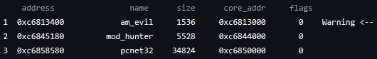

# ALIRT — Advanced Linux Incident Response Tool

**Developed and maintained by madsys, coolq — v0.5.1**

[](https://www.gnu.org/licenses/gpl-3.0)

ALIRT (Advanced Linux incident response tool, formerly known as **AIRT**) is a
set of Linux-based tools for incident response, specifically designed to detect
kernel backdoors on the Linux platform. It's useful when you want to know what
evil kernel backdoor is still resident on your broken system and what the hell
it is. ALIRT consists of 5 useful tools:

- **mod_hunter** — detect hidden modules on the suspect system (tri-source
  cross-validation: memory scan vs module list vs module kset, resilient
  against KoviD-class rootkits).
- **process_hunter** — detect hidden processes from kernel on the suspect system.
- **sock_hunter** — detect hidden net ports from kernel on the suspect system
  (supports IPv4 and IPv6).
- **modumper** — dump a suspect module's core image for offline analysis.
- **dismod** — analyze a dumped module via the system `objdump` (`dismod.sh`,
  multi-arch) or the legacy `dismod.pl`.

> **Note:** unlike signature-based scanners, ALIRT finds backdoors by their
> low-level structural traces in kernel memory — there is no signature database.

## Table of contents

1. [What is ALIRT?](#what-is-alirt)
2. [How can I use it?](#how-can-i-use-it)
3. [What platforms does it support now?](#what-platforms-does-it-support-now)
4. [Where can I get the latest version?](#where-can-i-get-the-latest-version)
5. [How can I report a bug?](#how-can-i-report-a-bug)
6. [Documentation](#documentation)
7. [License](#license)

## What is ALIRT?

*(See the introduction above.)*

## How can I use it?

Unpack the sources, enter the top directory and just execute:

```sh
make
```

The modules are built into `src/<tool>/` (e.g. `src/mod_hunter/mod_hunter.ko`).
Dependencies: kernel headers for the target kernel (`linux-headers` /
`kernel-devel` package), `make`, `gcc`. On Secure Boot / module-signature
enforced systems, enroll a MOK and sign the modules before loading
(`dkms` + `mokutil` on Debian/Ubuntu; `sign-file` from the kernel tree on
RHEL-likes).

### mod_hunter

to check if there is hidden module in your system, just run:
```sh
$ sudo insmod src/mod_hunter/mod_hunter.ko && cat /proc/showmodules
```
Suspicious struct module candidates are reported with a verdict
(CRITICAL / HIGH / MEDIUM / SUSPICIOUS) based on three data sources:

```text
verdict    address              name            core_size  in_list  in_kset
CRITICAL   0xffffc90000012340   am_evil         16384      no       no
VISIBLE    0xffffc90000023480   pcnet32         34824      yes      yes
```

to inspect a suspect module in place, just try:

```sh
$ sudo echo "0xffffc90000012340" > /proc/showmodules
```

> **Note:** the address is the one reported in the scan output. On kernels
> >= 4.0 this prints full details and recommends a manual dump (no automatic
> re-linking — recovery decisions belong to the analyst). On older kernels
> (<= 3.x) pass `reveal=1` at insmod to optionally re-link the module for
> removal, at your own risk.

**mod_hunter workflow diagram:**



### process_hunter

to check if there is hidden process in your system:

```sh
$ sudo insmod src/process_hunter/process_hunter.ko && cat /proc/showprocess
```

### sock_hunter

to check if there is hidden port in your system:

```sh
$ sudo insmod src/sock_hunter/sock_hunter.ko && cat /proc/showsocks
```

### modumper + dismod

to dump a module's core image:

```sh
$ sudo insmod src/mod_dumper/modumper.ko mod_name=MODULE && cat /proc/get_mod
```

On kernels <= 5.9 this writes `dump.dat` & `dump.info` to the current
directory; on kernels >= 5.10 (where kernel-space file writing is no longer
possible) the dump is emitted through `/proc/get_mod` — convert it with
`src/mod_dumper/dump-extract.sh`.

to disassemble the dump (supports x86, x86_64, arm, arm64, mips, powerpc,
riscv — via the system binutils):

```sh
$ src/mod_dumper/dismod.sh dump.dat        # or: src/mod_dumper/dismod.pl
```

## What platforms it support now?

- **x86_64**: kernel 3.10 — 6.12 (CI-verified matrix); 2.6.32+ covered by
  version conditionals. Other architectures (arm64, armv7, mips, powerpc,
  riscv) are stubbed in `src/arch/` — they compile and load with a clear
  "not yet supported" message.
- Every push is compile-tested and runtime-tested (hidden-module detection
  against a self-hiding sample in QEMU) across the kernel matrix — see
  `.github/workflows/ci.yml` and the compatibility matrix in the latest
  CI run summary.

## Where can I get the latest version?

- GitHub: <https://github.com/madsys/ALIRT>

## How can I report a bug?

We are glad to receive any comments, bugs and suggestions — please mail to:

- madsys@gmail.com

## Documentation

- [THANKS](THANKS) — credits.

## License

This project is licensed under the **GNU General Public License v3.0** — see the
[LICENSE](LICENSE) file for details.
